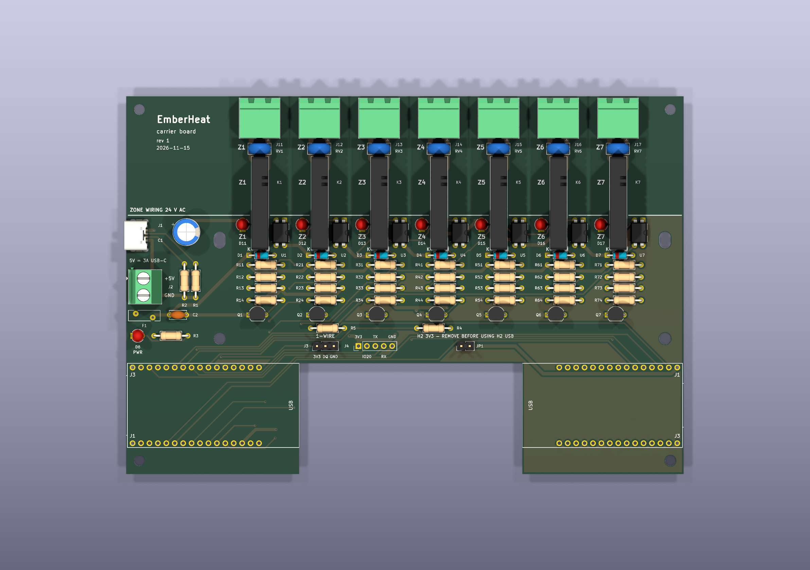

# EmberHeat carrier board

A KiCad board, 168 x 114 mm, that holds an ESP32-C6-DevKitC-1 and an ESP32-H2-DevKitM-1 on sockets, switches seven zone circuits (24 V AC, one dry relay contact each) and takes its power from a USB-C supply. It mounts on a 35 mm DIN rail with two clips. Nothing on it connects to the 24 V AC except the relay contacts and the zone terminals.



**Status: designed and checked by software only.** The board has not been fabricated or assembled. No part has been test-fitted against its footprint. Distributor stock came from search snapshots, not live pages. The current in a zone circuit has not been measured. How far the back of the board sits from the metal rail is not established (see [Assembly](#assembly)). The [Known gaps](#known-gaps) section lists everything else. Read it before you order.

This board controls a heating system. It is a one-off built for one house, not a certified product. A mistake can leave a zone's valve open (heat on) or shut (no heat).

## Files

- `bom.csv`: one row per distinct part, with the exact KiCad symbol and footprint names.
- `part-checks.md`: datasheet figures that justify each part, and the drive arithmetic.
- `scripts/check_bom.py`: checks the bill of materials.
- `lib/`: dev board symbols and footprints and the DIN clip holes, written by `scripts/gen_lib.py` (`make lib`). `sym-lib-table` and `fp-lib-table` name it `emberheat`.
- `scripts/expected.py`: the pin lists and dimensions the checks compare the library against, written by hand.
- `scripts/check_lib.py`: checks the library, including that the sockets are not mirrored or reversed.
- `carrier-board.kicad_sch`: the schematic, written by `scripts/gen_schematic.py` (`make sch`, which also writes `build/netlist.xml`). Do not edit it by hand.
- `scripts/check_netlist.py`: checks the netlist against `expected.NETS`, the firmware's relay GPIOs and the datasheet pinouts.
- `scripts/check_erc.py` (and `make erc`): KiCad's electrical rules check, all severities; it must report 0 violations. No ERC exclusions are used.
- `make render`: writes `renders/schematic.png` (KiCad SVG export, cleaned by `scripts/svg_for_magick.py`, then ImageMagick).
- `carrier-board.kicad_pcb`: the board. `make board` (`scripts/gen_board.py`) places every part, draws the outline and silkscreen and routes the zone side (24 V AC, locked tracks); `make route` (`scripts/route.py`) routes the logic side and adds the ground pours, writing over the same file. Do not edit it by hand.
- `carrier-board.kicad_dru`: custom design rules: 3.0 mm between zone-side and logic-side copper; no logic-side track, via or pour in the zone strip (the rule area named `zone_strip`); tracks 0.5 mm from other-net through-hole pads; the dev boards' outlines on the silkscreen may meet the board edge.
- `routing/carrier-board.ses`: the Freerouting session `make route` replays, and `routing/carrier-board.dsn.sha256`, the router input it was made from.
- `make render-board`: writes `renders/board-*.png`: 3D views of both sides, each copper layer with its silkscreen as built (`*-layers.png`), and again without the ground pours so the tracks can be seen (`*-tracks.png`).
- `scripts/check_board.py`: checks the board against the netlist and the design, runs KiCad's design rule check, and checks `fab/`.
- `fab/`: what you send to the board house, and the print template. See [Fabrication files](#fabrication-files).
- `scripts/print_template.py`: makes the copy of the board that `fab/print-template.pdf` is plotted from.

## Ordering

Order from `bom.csv`, with these additions it does not list as rows (they are only in its notes). Check each against the manufacturer's part number on the distributor's page before paying.

| What | Part | Qty | Note |
|---|---|---|---|
| Circuit board | `fab/carrier-board-gerbers.zip` | 1 board (or the house's minimum) | 2 layers, 1.6 mm, 168 x 114 mm. Smallest hole 0.4 mm (vias); smallest track and gap 0.25 mm. Not checked against any board house's limits. |
| Relay K1-K7 | Finder 34.51.7.005.5010 | 7 | 5 V coil (38.4 mA at 5 V, 130 ohm), AgNi + Au contacts, 6 A 250 V AC, minimum load 5 V / 2 mA. Flux-proof, not washable. |
| Zone terminal header J11-J17 | Phoenix 1757242 (MSTBA 2,5/2-G-5,08) | 7 | Soldered to the board. |
| **Zone terminal plug** | **Phoenix 1757019 (MSTB 2,5/2-ST-5,08)** | **7** | **Not a board part, so easy to forget. Without it nothing connects to the headers.** |
| Optocoupler U1-U7 | Lite-On LTV-817 | 7 | Any rank letter. |
| Transistor Q1-Q7 | onsemi 2N3904 | 7 | Must be the EBC pinout (onsemi). Some makers sell CBE parts, which would be wrong. |
| Flyback diode D1-D7 | onsemi 1N4148 | 7 | |
| Varistor RV1-RV7 | Littelfuse V56ZA2P | 7 | 35 V AC, 7 mm disc, 5 mm lead pitch. |
| Zone light D11-D17 / power light D8 | Kingbright WP7113ID (red) / WP7113GD (green) | 7 / 1 | |
| Resistors | Yageo CFR-25JB-52 series: 330 R x7, 1 k x15, 10 k x8, 5.1 k x2, 4.7 k x1 | 33 | Refs in `bom.csv`. |
| USB-C socket J1 | GCT USB4125-GF-A | 1 | The only surface-mount part. Power only. |
| 5 V screw terminal J2 | Phoenix 1729128 | 1 | |
| Fuse F1 | Bourns MF-RHT200-0 | 1 | 2.0 A hold, 3.8 A trip. |
| C1, C2 | Panasonic EEU-FR1A471 (470 uF), Kemet C317C104K5R5TA (100 nF) | 1 each | C1 is polarised: positive to +5 V. |
| Dev board sockets A1, A2 | Samtec SSW-116-01-T-S (C6), SSW-115-01-T-S (H2) | **2 of each (4 strips)** | One strip per side of each dev board. `bom.csv` lists one row each. |
| **JP1 shunt** | Samtec SNT-100-BK-T | **1** | Goes on the JP1 header (H2 3.3 V feed). Listed only in the note of the JP1 row. |
| JP1, J3 headers | Samtec TSW-102-07-T-S, TSW-103-07-T-S | 1 each | |
| DIN clips H5, H6 | Hammond 1427DINCLIP | **1 pack (2 clips + 4 screws)** | Digi-Key HM1489-ND. |
| Dev boards | ESP32-C6-DevKitC-1, ESP32-H2-DevKitM-1 | 1 each | You already have these. |
| DIN rail | 35 mm top-hat | | Not in `bom.csv`. |
| 5 V supply | USB-C, 5 V, rated 3 A | 1 | See Power. |

J4 (five spare pads for 3V3, GPIO20, TX, RX, GND) is **not fitted**: buy nothing for it. The four M3 corner holes take M3 screws if you want to fix the board by them; no screws are in `bom.csv`.

## Power

Use a 5 V USB-C supply rated 3 A. A supply that offers only 0.5-0.9 A will sag when several relays close and reset the C6, which opens the relays. That is safe but a nuisance. The worst case estimate is about 1 A at 5 V.

- The 5 V input is the USB-C socket (J1, power only: no data lines) or the 2-way screw terminal J2 (labelled +5V and GND). Use one at a time.
- A resettable fuse F1 (2.0 A hold) follows the input.
- The 5 V rail feeds the relay coils, the zone lights and the C6 board's 5V pin. The C6 board makes the 3.3 V, which also feeds the H2 and the optocoupler LEDs.
- You can plug a computer into the C6 board's own USB port while the carrier is powered. Each USB port on the DevKitC-1 has a diode between it and the 5V pin (Espressif schematic V1.1; see `part-checks.md`), so the two 5 V sources do not feed each other.
- **The C6 dev board's own 3V3 jumper (J5 on the DevKitC-1) must be fitted**, as it is when the board ships. The carrier's 3.3 V rail comes from the C6's 3V3 header pin, which sits behind that jumper. With J5 removed the optocouplers and the H2 get no power.
- Nothing on the carrier uses, measures or shares the 24 V AC.

## The H2 jumper

JP1 is a 2-pin header with a shunt in the H2's 3.3 V feed. The board labels it `H2 3V3 — REMOVE BEFORE USING H2 USB`.

- Normal use: shunt fitted. The H2 runs from the C6 board's 3.3 V.
- **Before you plug a cable into the H2 board's own USB port (to flash it), remove the shunt.** Otherwise the two dev boards' 3.3 V regulators are connected together.

## Wiring

Each zone is a pair of wires closed by one relay contact (contacts 11 and 14, normally open; the normally closed contact 12 is not connected). The terminal plugs take 0.2-2.5 mm2 wire (18 AWG fits bare or in a 1.0 mm2 ferrule). The two wires of a pair are interchangeable. The relay is driven active-low: the C6 pin LOW closes the relay, as the firmware does.

| Zone | Terminal | Relay | Optocoupler | Transistor | Zone light | C6 GPIO | C6 header pin |
|---|---|---|---|---|---|---|---|
| 1 | J11 (Z1) | K1 | U1 | Q1 | D11 | GPIO0 | J1 pin 7 |
| 2 | J12 (Z2) | K2 | U2 | Q2 | D12 | GPIO1 | J1 pin 8 |
| 3 | J13 (Z3) | K3 | U3 | Q3 | D13 | GPIO2 | J1 pin 12 |
| 4 | J14 (Z4) | K4 | U4 | Q4 | D14 | GPIO3 | J1 pin 13 |
| 5 | J15 (Z5) | K5 | U5 | Q5 | D15 | GPIO10 | J1 pin 10 |
| 6 | J16 (Z6) | K6 | U6 | Q6 | D16 | GPIO11 | J1 pin 11 |
| 7 | J17 (Z7) | K7 | U7 | Q7 | D17 | GPIO22 | J3 pin 6 |

The zone terminals run along the top edge, Z1 on the left. Each channel: C6 GPIO, 330 ohm, optocoupler LED, to 3.3 V. The optocoupler transistor drives the 2N3904 through 1 k (with 10 k to ground), the 2N3904 switches the relay coil, and the zone light (with 1 k) sits across the coil.

**The zone light shows that the relay is being driven, not that the contact has closed.** A stuck or burnt contact still lights it. To know a zone is closed, measure across its terminals.

Other connections:

| C6 | H2 | Purpose |
|---|---|---|
| GPIO18 (10 k pull-up to 3.3 V) | GPIO0 | C6 transmit to H2 |
| GPIO19 | GPIO1 | H2 transmit to C6 |
| GPIO6 | GPIO2 | C6 ready-to-send |
| GPIO7 | GPIO3 | C6 clear-to-send |
| GPIO23 | RST | C6 resets the H2 |
| 3V3 (through JP1) | 3V3 | H2 power |
| GND | GND | Ground |

J3 is a 1-Wire sensor header (3V3, data on GPIO21, GND, 4.7 k pull-up). The current firmware does not use it. The C6 strapping pins (4, 5, 8, 9, 15), USB pins (12, 13), RST and both NC pins connect to nothing.

Enabling seven zones is a **firmware change**: `emberheat-esp32/src/config.rs` builds one zone (`NUM_ZONES = 1`) today with the seven-zone table commented out, and `test_relay_pins_are_valid_gpio` rejects GPIO22 until corrected. This board does not do that for you.

The zone circuit current has not been measured. The relays are rated 6 A, 250 V AC. If an AC current reading through one pair is above 2 A, revisit the relay choice before relying on the board (design decision, 2026-11-15).

## Assembly

**Warnings**

- Switch off the 24 V AC supply to the zone control board before touching zone wiring.
- The relays are flux-proof, not washable. Do not wash the board and do not use ultrasonic cleaning. Use a minimum of flux and wipe it locally if you must.
- The DIN clips fit one way only: **hook end up** (the back silkscreen marks the clip outline with `HOOK` at the hook end and `RAIL` where the rail runs). The other way round, a clip sits over solder joints.
- The back of the board has about 150 solder joints over the rail. See "Distance to the rail" below before you mount it.

Order, lowest parts first, so the board lies flat for each step (the heights of the parts were not checked, so use your judgement where parts are close in height):

1. USB-C socket J1 (surface mount, the only such part).
2. Diodes D1-D7 (banded end, the cathode, to +5 V) and all resistors.
3. 100 nF C2, varistors RV1-RV7, the fuse F1, headers JP1 and J3, transistors Q1-Q7, optocouplers U1-U7 (pin 1 is the LED anode side; see the schematic) and LEDs D8 and D11-D17. Check the polarity of every diode, LED, optocoupler and transistor against the schematic before soldering.
4. C1 (positive to +5 V), screw terminal J2, zone headers J11-J17.
5. Relays K1-K7.
6. The socket strips for the dev boards (A1: two 16-way, A2: two 15-way), seated using the dev board itself as a spacing jig so the strips line up.
7. Trim every lead on the back flush. Then fit the DIN clips last, hook end up, from the front with the screws (#6 x 1/4 in, self-tapping into the clip).

Leave J4 empty. Fit the JP1 shunt. Do not fit dev boards until the first test below is done.

### Distance to the rail

This could not be established, and the README does not guess it. Hammond's drawing of the clip (1427DINCLIP, revision 2) gives its overall height as 14.00 +/- 0.50 mm but does not dimension where the rail seats in the clip or how far the rail reaches toward the board. So the gap between the back of the board and the nearest metal of the rail is unknown, and for safety **assume it is under 5 mm**. The derivation and what the drawing does and does not give are in `part-checks.md`.

Before fitting the board:

1. **Measure the gap** with a clip on a piece of 35 mm rail: from the clip's mounting face (where the board's back would sit) to the nearest metal of the rail.
2. **Put an insulating sheet between the board and the rail** whatever the result: fish paper or 0.5 mm polycarbonate, cut to cover the band over the rail (board y 39.5 to 74.5 mm from the top edge, the full width), with room for the clip screws.
3. Keep every lead end and solder joint on the back well below the measured gap, with the sheet as a second barrier rather than a substitute.

About 148 plated joints lie in that band. The 24 V AC joints (relay contacts, varistors, zone terminals) are all in the top 26 mm of the board, outside the band.

## Checks

Three lists. A failed item means do not go on.

### Automated: `make -C hardware/carrier-board check`

This runs every `scripts/check_*.py`. It needs KiCad 9 at `/Applications/KiCad/KiCad.app`. Everything must pass.

- Schematic electrical rules check: no errors or warnings (`check_erc.py`).
- Board design rules check: no violations of any severity and no unconnected nets (`check_board.py`, `test_drc_clean`, which also checks `test_fully_routed`).
- Schematic and board agree (KiCad's schematic parity check, in the same test).
- The net on each C6 socket pin matches its role in `main.rs` and the table above (`check_netlist.py`, including the relay GPIOs and the inter-board nets, and the normally-open contact, diode, transistor, optocoupler and USB-C pull-down checks).
- Every zone-side copper item is at least 3 mm from every logic-side copper item on both layers (`test_zone_separation`, with `test_no_pour_in_zone_strip`; the measured figure is printed, currently 5.845 mm).
- Every track is at least 0.5 mm from through-hole pads of other nets (`test_track_to_through_hole_pads`; a rule added after review, tighter than the 0.25 mm general minimum).
- The dev board footprints are not mirrored or reversed (`check_lib.py`, `test_socket_orientation`).
- `fab/` is complete, belongs to this board and its drill files hold the board's holes (`test_fab_outputs`).

### By you, before ordering

- Print `fab/print-template.pdf` at **100 % (actual size)**, not "fit to page" and not "shrink to fit". Check the scale first: the ruler on the page must measure 100 mm and the board width 168 mm. Then set both dev boards on the paper: every pin must land on a pad, the USB ports must clear the edge and face the notch, and the antennas must overhang as drawn. This is also the check that the H2 board you have is the DevKitM-1 with the layout the footprint assumes.
- Check the relay, a terminal header and plug, and a DIN clip against the printed footprints and hole pattern, or against the parts in hand. Do the same for the other parts you have (resistor, LED, capacitor, USB-C socket).
- Open `carrier-board.kicad_sch` in KiCad and read one relay channel end to end.
- Measure the gap to the rail and decide on the insulating sheet (see Assembly).
- Check the order list above against the bill of materials and the distributors' live stock.

### By you, after assembly and before connecting zone wires

Do these in order. Zone wires stay disconnected throughout.

- With a meter before power: no short between +5V and GND, and no continuity between any zone terminal and GND or +5V.
- With **no dev boards fitted**, power the carrier: no relay closes (no click), no zone light is lit. The power light lights.
- With the C6 fitted (JP1 shunt and the C6's J5 jumper in place) and **held in reset**, and then during boot: no relay closes.
- Run the firmware and switch each zone from Apple Home: the right relay clicks and the right zone light comes on, **checked with a meter across each terminal** (not only by the light).
- Optional: an AC current reading through one wire pair (see Wiring).

Only then connect the zone wires.

## Fabrication files

`fab/` is generated by `make fab` and **committed**, so you can order without installing KiCad. After any change to the board, run `make fab` again; `make check` fails if `fab/` is from an older board.

| File | What |
|---|---|
| `carrier-board-gerbers.zip` | Everything the board house needs: the files below with `.gtl .gbl .gts .gbs .gto .gbo .gm1 .drl` |
| `carrier-board-F_Cu.gtl`, `carrier-board-B_Cu.gbl` | Copper, front and back |
| `carrier-board-F_Mask.gts`, `carrier-board-B_Mask.gbs` | Solder mask |
| `carrier-board-F_Silkscreen.gto`, `carrier-board-B_Silkscreen.gbo` | Silkscreen |
| `carrier-board-Edge_Cuts.gm1` | Outline |
| `carrier-board-PTH.drl`, `carrier-board-NPTH.drl` | Excellon drill files, plated and unplated (mm). The DIN clip slots (3.5 x 5.0 mm) are in the unplated file as routed slots; check that the house reads them. |
| `print-template.pdf` | The 1:1 paper template: outline, pad openings, drill holes, front silkscreen (with the dev boards' outlines) and a 100 mm ruler. A4 landscape; the board is centred so a printer's margins do not cut it. |
| `schematic.pdf` | The schematic. |
| `source.sha256` | Hash of the board file these were made from. |

No solder paste layer is made (the board is hand-assembled), and no position file (it would not be used).

Printing on US Letter at 100 % also works for the board and ruler, but Letter is narrower than A4, so the page edges, not the board, are cropped (this was not test-printed).

## Regenerating

```
make -C hardware/carrier-board        # library, schematic, board, route, fab, checks
make -C hardware/carrier-board fab    # fab/ only
make -C hardware/carrier-board check  # all checks
```

Tools: KiCad 9.0.7 (`kicad-cli` and its Python, at `/Applications/KiCad/KiCad.app`), `zip` and `shasum` for `fab/`. ImageMagick (`magick`) for `make render` and `make render-board` only. Java and Freerouting only for `make autoroute`. The generated files in `fab/` carry the date they were made, so a regenerated `fab/` differs byte for byte but not in content.

## Routing

The logic side is routed by [Freerouting](https://github.com/freerouting/freerouting), run headless by `scripts/route.py`.

- Version 2.5.0, from https://github.com/freerouting/freerouting/releases/download/v2.5.0/freerouting-2.5.0.jar
- SHA-256 `f6f51bb02245e8e717f9359bd260cc9c5c0b1bc0acc8b7cb2cd5b8ffeb5de3c7` (route.py refuses any other file)
- Put it at `tools/freerouting-2.5.0.jar` (`tools/` is not committed). It needs Java (tested with OpenJDK 27).

Freerouting does not give the same routing twice from the same input, so the session it made is committed and `make route` replays it: no Java needed, the same board every time. `make route` refuses to run if the router's input (the placed board) has changed since the session was made. `make autoroute` runs Freerouting three times (headless, at most 100 passes, 15 minutes each), keeps the session with the fewest vias, and then routes as `make route`; it gives a different result every run, so run it only after a change to placement, net classes, rules or the pre-routed tracks, and then run `make fab check` and re-check the new board.

What route.py does around the router:

- Zone strip: the router sees a keepout over the strip, less a 0.6 mm moat round the zone copper (too narrow for any track or via), so no logic track can enter it. The board itself keeps a plain named rule area there (`zone_strip`) and the rule in `carrier-board.kicad_dru` forbids logic tracks, vias and pours in it: a keepout on the board would also flag the zone tracks.
- Board edges: 0.5 mm track and via keepouts, as Freerouting knows only the 0.25 mm net clearance. No vias under the relays.
- Hand soldering: every track is at least 0.5 mm from every through-hole pad of another net, so a solder bridge at a joint does not short a supply. The router gets this by geometry: in its copy of the board every through-hole pad is 0.25 mm larger on every side (the 3 mm LEDs' two pads grow less on the side facing each other, where no track fits anyway), so its ordinary 0.25 mm clearance lands tracks 0.5 mm from the real pads. Tracks end on pad centres, so the real board's connections are the same. The ground pour keeps 0.5 mm too. The rule `tracks 0.5 mm from other-net through-hole pads` in `carrier-board.kicad_dru` makes KiCad's DRC check it, and `check_board.py` measures it independently.
- USB-C VBUS (net VIN) is drawn by hand: its pads are too narrow for a 1.0 mm track, so it leaves each pad at 0.5 mm for 1.07 mm and then runs at 1.0 mm (A9 down the front to J2, B9 through one via down the back), and on to the fuse.
- Ground pours on both layers below the zone line, with thermal reliefs (0.5 mm gap and spokes) on through-hole pads for hand soldering. A thermal relief whose spokes reach only an island of fill that connects the pad to nothing is a design rule error; route.py removes such islands with small pour keepouts (`no_pour_*` rule areas), or turns a pad's spokes 45 degrees where fewer than two reach the pour.

## Not covered by this board

- **Firmware that is running but stuck with a relay pin held LOW.** The board has no hardware watchdog. The firmware's crash fail-safe (relays off and restart on a panic or hang) handles this; a board-level watchdog is left for a later revision.
- **Enabling seven zones** is a firmware change (see Wiring).
- Solid-state relays, a closed enclosure, an eighth relay, powering from the 24 V AC, on-board USB data and an on-board 3.3 V regulator are not in this revision.

## Known gaps

From going through the design (`docs/plans/2026-11-15-carrier-board-design.md`) section by section against the board, the netlist and this README. Items marked "not confirmed" could not be checked from here.

- **Nothing has been built.** The board has not been fabricated or assembled and no part has been test-fitted. Every footprint comes from KiCad's library or a datasheet drawing; the paper print is the first physical check. Distributor stock came from search snapshots, not live pages, and was not rechecked.
- **Gap between the board's back and the DIN rail: not established** (Hammond's drawing does not give it). About 148 logic-side joints lie over the rail. The owner must measure it and add an insulating sheet; see Assembly.
- **Zone circuit current: not measured.** The relay (6 A) and varistor (35 V AC continuous; clamps 110 V at a 2.5 A test current, higher at higher surge current) were chosen without it.
- **Relays must stay open in every start-up state: only partly confirmed.** By design and arithmetic, the only path that closes a relay is current through an optocoupler LED from a C6 pin pulled LOW, so an unpowered, absent, floating or high pin leaves it open (checked in the netlist and in `part-checks.md`). The state of each of the seven C6 pins during reset and the boot ROM was not looked up, and nothing was tried on hardware. The after-assembly tests are the confirmation.
- **Dev board fit: not confirmed.** The ESP32-H2-DevKitM-1 is the board that matches what the design describes; the owner's board has not been compared. The Espressif schematics read were C6-DevKitC-1 V1.1 and H2-DevKitM-1 V1.3; later C6 revisions (to v1.4) were not fetched, though Espressif's guide says only resistor values change.
- **Board size is 168 x 114 mm**, against the design's rough estimate of 160 x 100 mm (not a requirement). The dev boards were raised 8 mm from the bottom edge so the bottom corner holes clear their pins. The notch is 67.24 x 33.40 mm.
- **Relay has a changeover contact**, where the design says a single normally-open contact. The normally closed pin (12) is left unconnected, so the behaviour is the same. The Finder datasheet figures (edition II-2026) are used; the coil takes 38.4 mA, not the 34 mA the plan quoted, and the drive arithmetic uses 38.4 mA.
- **Power-decoupling distance:** C1 (470 uF) is 22.7 mm from the nearest relay coil pad; the design says "near the relays". Not confirmed to matter.
- **Parts not fully checked against datasheets:** the Kingbright zone light forward voltage is assumed (about 2 V; its datasheet was not read); the GCT USB-C datasheet was not retrieved; the varistor body width (W3.4 mm) is not confirmed (the holes are); the J2 footprint is the MKDS outline while the part is MKDSN (pitch and drill match).
- **Heights and clearances above the board: not checked.** The design says the dev boards sit about 11 mm above the carrier and the assembly is about 25 mm high. Socket strip and relay heights were not checked, and nothing checks that the dev boards clear tall parts.
- **Board house limits: not checked** (smallest hole 0.4 mm, track and gap 0.25 mm; routed slots for the DIN clips).
- **The print template was viewed as an image only**; it was not test-printed, so the printed scale is confirmed by KiCad's plot and the page size, not by a ruler on a printout. Check the ruler yourself (see Checks).
- **Firmware**: no firmware file was changed. The build still has one zone and the seven-zone table needs enabling, with the GPIO22 test corrected.
- **Zone-side fuse: none.** The board has no fuse on the 24 V AC pairs (not required by the design).
